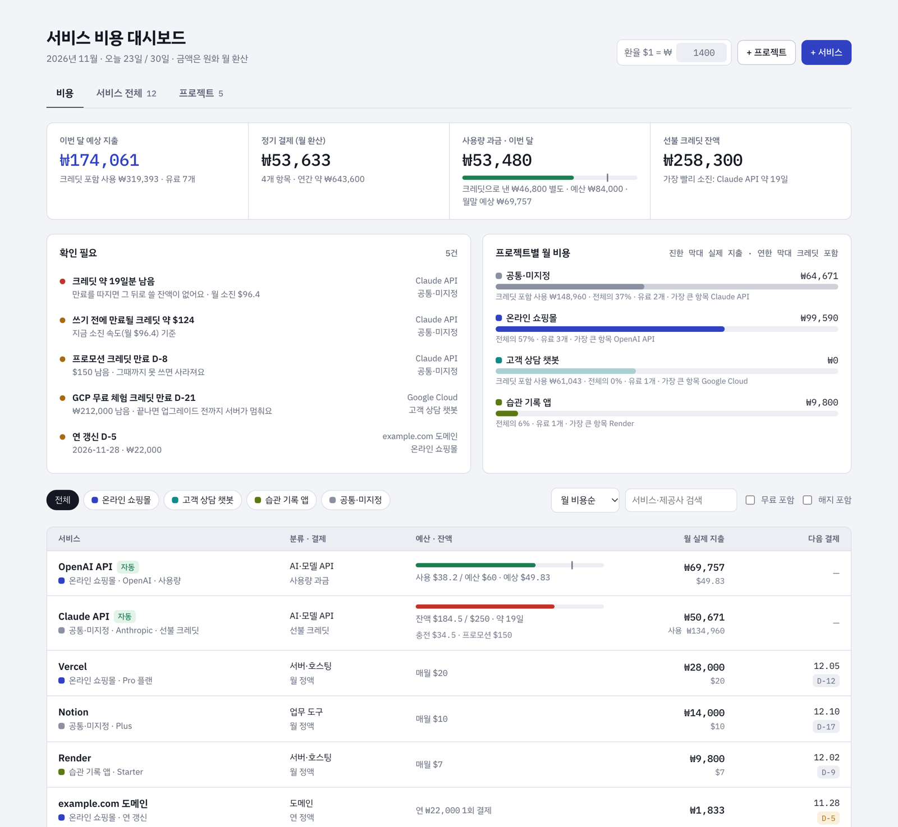
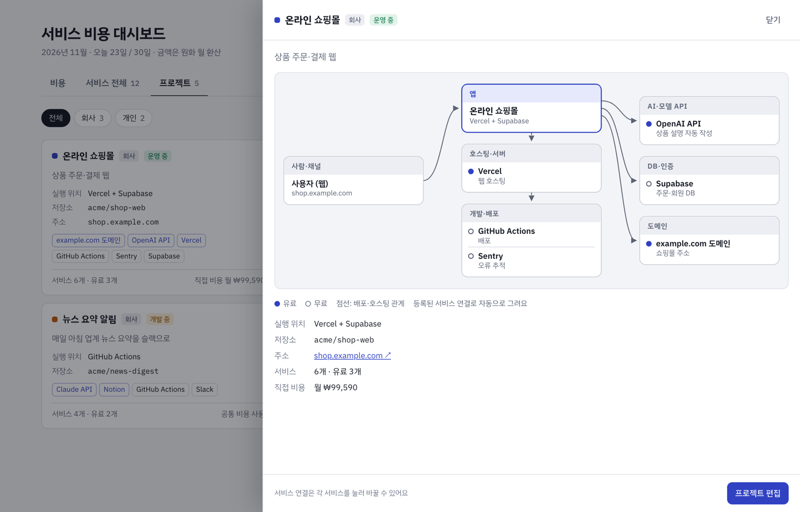

# 서비스 비용 대시보드

내 프로젝트들이 쓰는 외부 서비스와 비용을 한눈에.

## 시작 — Claude Code나 Codex에 그대로 붙여 넣기

```
초기 세팅: 템플릿 fkal829/service-cost-ledger-template
1) gh repo create service-cost-ledger --private --template fkal829/service-cost-ledger-template --clone
2) 그 폴더의 .claude/skills/ledger-setup/SKILL.md 대로 진행
```

> [!TIP]
> **준비물** [Claude Code](https://claude.com/claude-code) 또는 [Codex](https://github.com/openai/codex) · [GitHub CLI](https://cli.github.com) (`gh auth login`) · [Node.js](https://nodejs.org) 18+<br>
> **그다음엔** `갱신` · `정리` · `버전 업데이트` 한 단어면 돼요. 갱신 전에는 초기 세팅 때 알려 주는 결제 사이트에 Chrome으로 로그인해 두세요.<br>
> **보기** [fkal829.github.io/service-cost-ledger-template](https://fkal829.github.io/service-cost-ledger-template/)



<br>

---

<br>

## 자세히

### 무엇을 보여 주나요
- 어떤 프로젝트가 어떤 외부 서비스(API, 서버, DB, SaaS…)를 **무엇에** 쓰는지
- 이번 달 **실제로 나가는 돈**과 크레딧으로 덮이는 몫
- 선불·무료 체험 **크레딧이 언제 끝나는지**, 쓰기 전에 사라질 금액
- 프로젝트마다 자동으로 그려지는 구성도



<sub>화면은 모두 예시 데이터예요.</sub>

### 어떻게 동작하나요
- **데이터를 저장할 레포가 하나 필요해요.** 내 GitHub에 비공개 레포(`service-cost-ledger`)를 하나 만들어 거기에 저장해요. 따로 서버나 DB가 없고, 특정 AI 계정에 묶이지도 않아요.
- **화면은 공용 대시보드**에서 봐요. 대시보드에는 데이터가 없고, 내 브라우저가 내 레포에서 바로 읽어 와요.
- **채우고 갱신하는 건 AI**(Claude Code나 Codex)가 해요.

### 초기 세팅 때 AI가 하는 일
1. 데이터를 저장할 **비공개** 레포 `service-cost-ledger`를 내 GitHub에 만들어 받아요.
2. 내 레포들을 읽어 프로젝트와 외부 서비스를 정리해 채워요. 어느 계정·조직을 넣을지만 물어봐요.
3. 내 레포에서 찾은 **유료 서비스만 골라** 비용을 어디서 읽을지 정하고, **로그인해 둘 사이트 목록**을 알려 줘요.
4. 보는 방법을 알려 줘요.

이미 데이터 레포가 있으면, 그 폴더를 Claude Code나 Codex로 열고 `초기 세팅`이라고만 하면 돼요.

### AI에게 쓰는 말
| 말 | 하는 일 |
|---|---|
| `초기 세팅` | 처음 한 번. 데이터 레포를 만들고, 내 레포들을 읽어 채우고, 보는 법을 안내 |
| `갱신` | 새 레포·서비스 확인 + Chrome에서 이미 로그인된 청구 화면(GCP, Claude Console, Vercel, OpenAI…)을 **읽기만** 해서 비용·크레딧 갱신 |
| `정리` | 갱신 때 찾은 새 레포·서비스의 설명을 코드를 읽고 다듬음, 애매한 것 물어봄 |
| `버전 업데이트` | 이 템플릿의 새 버전 코드를 받음 (데이터는 그대로). 새 버전이 나오면 대시보드 위에 알림이 떠요 |

데이터 레포 폴더를 열면 Claude Code든 Codex든 같은 절차 문서(`.claude/skills/`, 안내는 `AGENTS.md`)를 따라요. 정해진 시간에 혼자 도는 작업은 없어요. 오래 갱신하지 않으면 대시보드 위에 "마지막 갱신 ○일 전" 알림이 떠요. 크레딧 만료 알림은 날짜로 계산해서 갱신하지 않아도 떠요.

### Claude Code와 Codex 차이
| | Claude Code | Codex |
|---|---|---|
| 초기 세팅, 정리, 버전 업데이트 | ✅ | ✅ |
| 갱신: 새 레포·서비스 확인 | ✅ | ✅ |
| 갱신: 결제 화면 자동으로 읽기 | ✅ (Chrome에 Claude in Chrome 확장) | 브라우저 도구가 없으면 숫자를 물어보고 받아 적어요 |

결제 사이트 로그인이 풀려 있으면 그 곳만 건너뛰고, 대시보드 "확인 필요"에 **결제 화면 로그인 필요**와 로그인할 주소가 떠요.

### 보는 법
공용 대시보드 https://fkal829.github.io/service-cost-ledger-template/ 에서 봐요. 컴퓨터든 휴대폰이든 같은 주소예요. 처음 한 번 GitHub 토큰을 넣으면 돼요 (페이지에 만드는 법이 있어요).

공용 대시보드에는 데이터가 없어요. 페이지를 연 사람의 브라우저가 그 사람 토큰으로 **그 사람 레포**에서 바로 읽어요. 그래서 같은 주소를 열어도 사람마다 자기 데이터가 보이고, 다른 사람(페이지 만든 사람 포함)에게 데이터가 가지 않아요. 토큰은 **데이터 레포 하나만** 고를 수 있게 만드세요.

### 안전
- 키·토큰·비밀번호는 데이터에 적지 않아요. 레포를 읽을 때도 환경변수 **이름**만 보고 `.env` 같은 실제 값 파일은 열지 않아요.
- 청구 화면은 읽기만 하고 결제·업그레이드·설정 버튼은 누르지 않아요.
- 데이터 레포는 꼭 **Private**로 두세요.

### 파일
- `data/ledger.json` 데이터 · `data/signatures.json` 서비스 알아보는 규칙 · `data/scan-config.json` 스캔 대상 · `data/cost-sources.json` 비용 읽을 곳
- `docs/index.html` 대시보드 · `scripts/` 레포 확인·데이터 고치기·업데이트 · `.claude/skills/` 절차 문서 · `AGENTS.md` AI용 안내

### 라이선스
[MIT](LICENSE) — 자유롭게 쓰고 고치고 나눠도 돼요. 저작권 표시만 남겨 주세요.
